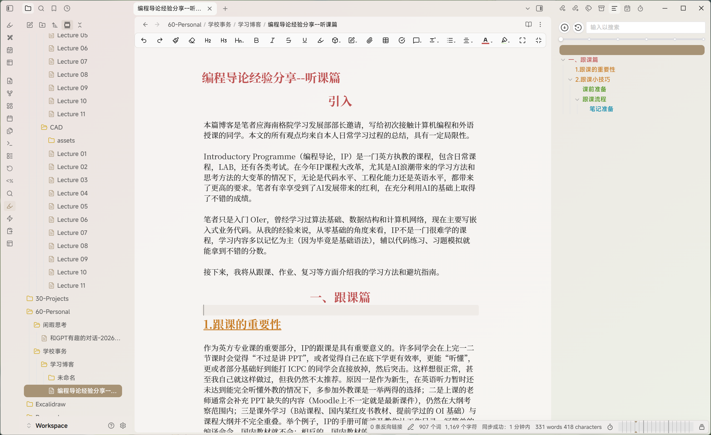
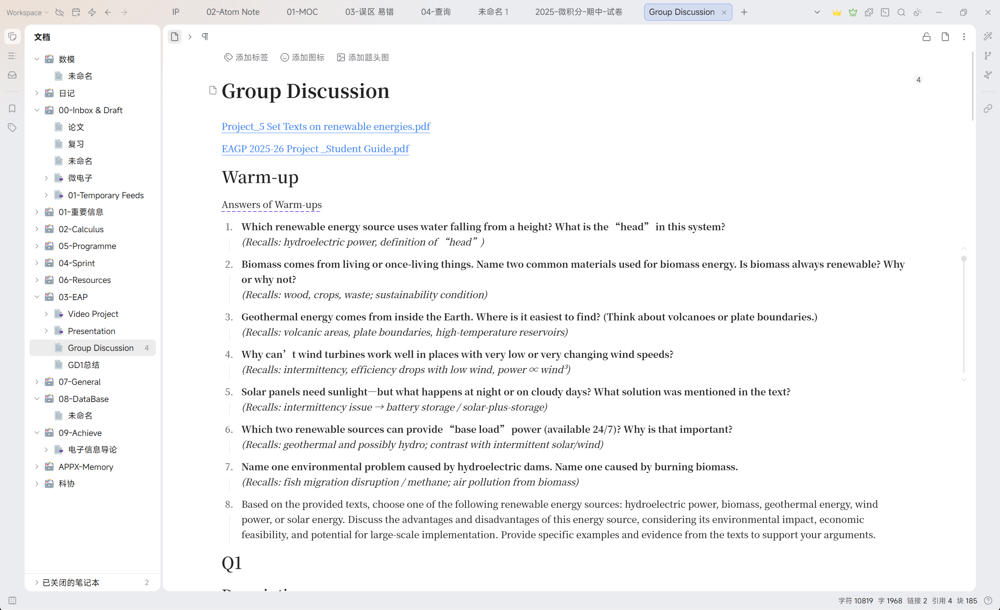
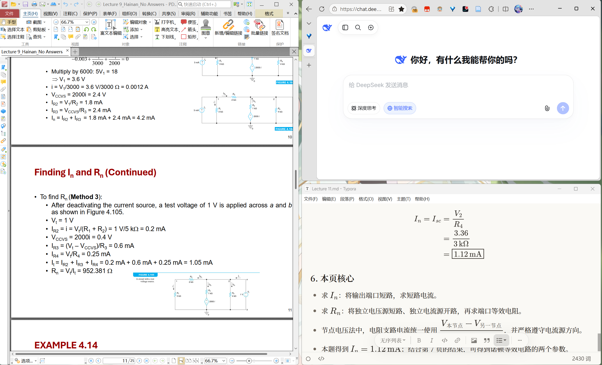

# 引入

本篇博客是笔者应海南格院学习发展部部长邀请，写给初次接触计算机编程和外语授课的同学。本文的所有观点均来自本人日常学习过程的总结，具有一定局限性。

`Introductory Programme`（`编程导论`，`IP`）是一门英方执教的课程，包含日常课程、LAB，还有各类考试。在今年 IP 课程大改革，尤其是 AI 浪潮带来的学习方法和思考方法的大变革的情况下，无论是代码水平、工程化能力还是英语水平，都带来了更高的要求。笔者有幸享受到了 AI 发展带来的红利，在充分利用 AI 的基础上取得了不错的成绩。

笔者只是入门 `OIer`，曾经学习过算法基础、数据结构和计算机网络，现在主要写嵌入式业务代码。从我的经验来说，从零基础的角度来看，IP 不是一门很难学的课程，学习内容多以记忆为主（因为毕竟是基础语法），辅以代码练习、习题模拟就能拿到不错的分数。

接下来，我将从跟课、作业、复习等方面介绍我的学习方法和避坑指南。

# 一、跟课篇

## 1. 跟课的重要性

作为英方专业课的重要部分，IP 的跟课是具有重要意义的。许多同学会在上完一二节课时会觉得“不过是讲 PPT”，或者觉得自己在底下学更有效率，更能“听懂”，更或者部分基础好到能打 ICPC 的同学会直接放掉，然后突击。这样想很正常，甚至我自己就这样做过，但我仍然不太推荐。

原因一是作为新生，在英语听力暂时还未达到能完全听懂外教的情况下，多参加外教课是一举两得的选择；二是上课的老师通常会补充 PPT 缺失的内容（Moodle 上不一定就是最新课件），仍然在大纲考察范围内；三是课外学习（B 站课程、国内某红皮书教材、提前学过的 OI 基础）与课程大纲并不完全重叠。举个例子，IP 的手册可能涉及教你认工作目录、写简单的编译命令，国内教材就不会；相反的，国内教材的内存管理学习的相对深入，IP 就不会这样深入；四是上课过程会有互动，简单的问题加反馈可以让你更好的理解本质。

## 2. 跟课小技巧

### 课前准备

一般不会怎么准备是绝大多数同学的选择，这一点没错，但是一下内容你需要提前做好。

- 课程学习文件夹准备
  无论你是 IPad 手写笔记还是电脑笔记，都需要你在课前打开对应文件夹，做好分类。
- 课件提前下载与准备
  提前到 Moodle 下完整个学期的课件，要看时候直接打开。
- 设置自己的工作区
  无论你是电脑也好平板也罢，左右分屏打开课件与笔记或者 AI 助手。

### 跟课流程

这里提前声明，以下是笔者在跟课时的工作流，读者可以参考，不必照抄。

#### 笔记准备

这里我使用一款基于 Markdown 语言的知识库整理软件 **Obsidian** 来完成知识归档，请注意，此软件功能拓展极其强大，这里我不做赘述，但基础功能足够使用。（除此之外，**思源笔记** 也是不错的选择，相比于 OB 更简单好上手，没接触过的同学选这个）





#### 核心笔记构建

由于 IP 课程涉及大量代码、表格还有专业术语，使用手写笔记对笔者而言比较困难，故我采用 AI 作为课件阅读者与整理者，自己当审核兼学习。提前截图加复制几张语义连续的课件发送给 AI，同时将回答粘贴在自己的笔记并且迅速阅读，发现问题直接反馈 AI 然后回答，当场答疑并记录。

这样一来不仅能降低听英文课时的理解负担，同时做完了笔记（是本人能够理解的），而且相当于听了两遍课程，理解加深。但这样带来几个误区：

- 我为什么不直接发完一整个 PPT 而是截图？
  在我的使用中，按一个完整知识点分批提问，更方便核对回答与课件是否一致。
- 我为什么不私下做而是到课上做？
  私下做会让人想翘课，但是一旦翘课，自己也就根本想不起来做了。

#### 设置工作区

通过分屏，将课件、AI、编辑器放在一个屏幕上，以达到以下效果：



#### 优劣

这样做好处在于阅读了电子笔记、完成了记录归档、降低了理解负担，同时还可以就课上疑问即时问清楚。

缺点也存在：不如手写的记忆深刻；笔记记忆不方便，易混乱。

通常情况下，我们可以通过提示词约束回答，实现格式的统一，以下是我常用的提示词。

```markdown
请根据截图整理适合保存为 Markdown 笔记的内容：

1. 每张 PPT 使用一个二级标题，标题下按需使用三级标题。
2. 以截图内容为主；补充解释请单独标注。
3. 英文专业术语首次出现时，附上中文含义。
4. 保留关键代码、公式和易错点，解释简洁。
5. 截图有页码时标注页码，没有则不添加。
6. 无法辨认或不能确定的内容请明确说明。
7. 将整理结果放在代码块中，结尾不追加提问。
```

## 3. 课后复习

IP 课程一般不需要即时的课后复习，想要得到语法训练可以完成课程 PPT 上指定的课本课后习题或者完成课上案例即可。

# 二、LAB 及复习篇

鉴于半期考试临近，本文档的后半部分将关注于一些考点分析和备考技巧。

## 推荐方法

关于半期考试，考试模式由原来的选择题笔试改为了现在的机考多题型（可能）。由于机考涉及手写代码，学习方式可能与之前有所不同。根据助教的描述，考察内容多以基础题为主，所以复习重心仍然是放在对基础知识的掌握和理解中。

笔者常用的复习方法是一套流程。

### Step 1 整理资料

在开始复习之前，你需要收集这些资料：

- 所有与考试内容相关的课件
- 所有中期考试相关的笔记（手写或电子）
- 所有通过助教、Moodle 或官网拿到的官方历年考试卷或相关复习资料

将这些资料保存妥善。

### Step 2 初步复习

从课件开始，逐页复习 PPT，同时将 AI 放在旁边，及时整理疑难点——通常情况下，AI 会很好的回答你的疑问。

将这个流程进行至完整复习所有课件，对知识点有了明确的概念与理解（虽然会有遗忘）。

在这个过程中，最值得系统整理的是各类知识点和易错点。比如，不同数据类型的存储大小、取值范围及相关特性（需要注意，具体大小可能受到平台、编译器和数据模型的影响，这也是去年考试中的一个易错点）；各类函数的用法与格式；转义字符的使用（例如，在 C 语言字符串中，使用 `\\` 表示一个反斜杠）；同义表达、变量与函数的声明位置，以及其他容易混淆的细节。

这些内容尤其容易出现在选择题和填空题中，建议整理成表格，便于对比和记忆。对于不熟悉的知识点，可以借助 AI 进行解释，也可以从往年试题中总结常见考法。例如，浮点数运算中，`0.3 - 0.1` 的结果通常不等于精确的 `0.2`，就是一个值得注意的细节。需要注意的是，AI 给出的结论也应当结合课程资料或实际代码进行核实。

易错点非常容易考察在选择填空，所以做题必须慎之又慎。

重点关注部分英文术语，防止考试时候忘记含义，影响做题。

### Step 3 模拟试题

完整复习之后，使用前几年的模拟卷给自己安排几次 `全真模拟`。模拟测试后记录错题和模糊的记忆，将它们完整的记录下来，解析清楚。

考虑到考试涉及机考手写代码，务必 `上手写代码`！上手写代码！手写代码！

你永远不知道你在机考的时候会出哪些问题：键盘用不惯，IDE 不会用，编译写不出，码字太慢思绪打断，语法总忘记，编译跑不通，测试不会做，波浪号去不掉，顺序写不对，循环漏次数，边界欠考虑。

很多同学图省事，以为看懂了就会写。但是 `看懂了` 和 `写的出来` 是相隔很大的理解台阶的，一定要亲身实践去编写构思代码，理解算法，写对语法，跑通编译与结果。

在对知识和题目有了系统认知和把握后可以尝试更深度、高阶的训练。

### Step 4 提升训练

这个时候通常有两种选择：

1. 回头复习课件笔记与坑点，重做错题，加深理解；
2. 使用 AI 辅助提升复习难度。

如果选择一，则要重点关注课后习题，针对地提升代码能力。

> 在 IP 阶段，代码能力的提升主要来自：
>
> 1. 自行完成对一道算法题的需求分析、算法设计、代码编写、错误处理、编译验证的循环，直到一道题目被 AC（算法强度不高，基本都是模拟题，不需要考虑更省时间或空间的算法）。
> 2. 对关键语法或复杂结构的熟练（码字流畅度）。
> 3. 一些代码规则的掌握（比如注释、变量名等 `clang.tidy` 规则）。

如果选择二，则要借助 AI 为你设计多套模拟题，题目可以从洛谷选入门或课本习题改编。然后同样以相同的要求完成，同时记忆易错点。

## 关于 LAB

首先，今年的 LAB 进行了较大的改革：手册由原来的一体化形式调整为题目与指导（Learning Guide）分开的形式。相较于往年，今年的题目更加情景化、工程化，但整体难度变化不大。同时，得益于这种分体式设计，题目难度呈阶梯式递增，对零基础的同学来说更加友好。

建议大家在正式完成 LAB 题目之前，先完整阅读并完成对应的 Learning Guide。它能够帮助大家提前熟悉相关知识，为后续的题目练习打下基础，而且完成后还可以获得额外的 bonus。

关于 LAB，笔者能够提供的经验相对有限。如果在完成过程中遇到困难，或者对某些知识点存在疑问，可以多向 AI 求助。但需要注意的是，AI 的回答不能成为模糊带过问题的理由。对于不理解的概念、语法和代码逻辑，一定要弄清楚并掌握，而不是仅仅得到一个能够运行的答案。

C 语言的基础语法看似简单，但在实际编程中，往往需要组合多种语法结构、控制流程和编程技巧，才能完成相对复杂的任务。对于这些写法，大家应当在理解其原理和作用的基础上使用，避免机械地复制代码。

毕竟，代码是你自己写出来的，助教询问你的实现思路和相关细节也是很正常的事情。**能够独立解释自己写出的代码，才算真正掌握了它。**

## 结语

回头看，学习 IP 最重要的，是逐渐完成几个转变：从听到英文术语时感到陌生，到能够理解老师的讲解；从看懂课件里的代码，到能够独立写出程序；从遇到报错就不知道怎么办，到能够检查、修改并验证自己的思路。

本文介绍的笔记工具、AI 用法和复习流程，都是帮助我完成这些转变的方法。大家不必照搬，也不必一开始就搭建一套复杂的学习系统。先找到自己当前最吃力的环节，再选择合适的方法解决它。

如果暂时不知道从哪里开始，不妨从下一节课做一个小尝试：课前浏览课件，课上记下没有听懂的地方，课后独立写出一个相关的小程序。遇到困难时，可以向老师、助教、同学或 AI 求助，再回过头来检查自己是否真正理解。

希望这篇分享能让大家在面对英文课堂和编程练习时，多一点方向，也少一点慌张。等到你能够不看答案写出程序，解释它为什么这样运行，并在出错时找到修改的方向，进步就已经发生了。